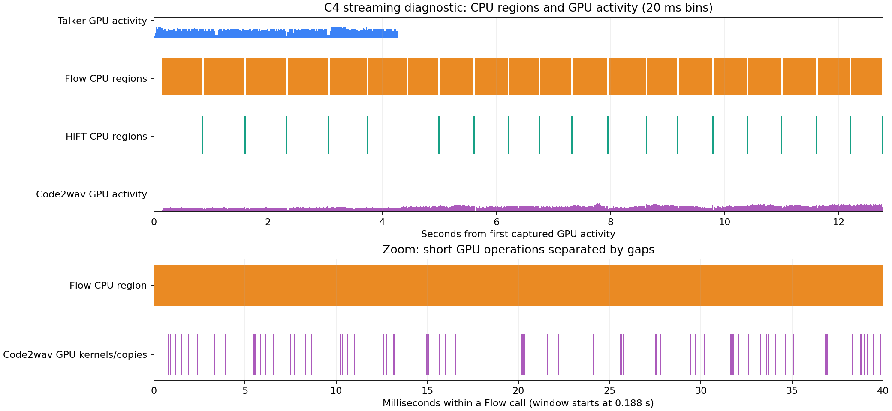

# CosyVoice3 eager Flow profile

CosyVoice3 eager 流式 C4 诊断

RTX PRO 6000 Blackwell Server Edition 96 GB，vLLM 0.34.0、PyTorch 2.14.0+cu130。通用 CosyVoice3 流式配置、Stage 0 FlashInfer、RAS。4 个英文文本共用一个参考音频。RTF 为逐请求端到端秒数除以生成音频秒数后取平均。C4 为客户端并发数。显式传 seed 时 stage 0 会隔离请求，不传 seed 才允许常规合批。数据仅覆盖本卡和这套语料。

显式 seed=42，关闭 TRT 和 DiT 编译。先预热四条请求，再用相同文本采集 CPU/CUDA。20 次 Flow，200 次 estimator，4,400 个 RoPE 区域，105,600 个相关设备操作。Flow 相关设备操作时间总和 1.596 s，HiFT 0.064 s。带 profiler 的测量用于选择候选。

在 [Perfetto](https://ui.perfetto.dev/) 点击 **Open trace file**，选择下载的 `.json.gz`。公开版保留全部事件、时间、轨道、算子名及数值关联 ID，裁去了宿主机名、输入值、自由文本参数等字段。文件指纹和逐类事件数量见 [trace-manifest.json](trace-manifest.json)。

[Talker](traces/stage0.json.gz) · [Flow / HiFT](traces/stage1.json.gz) · [实际 Perfetto 截图](perfetto-flow-detail.png)

## Read the timeline

Top panel uses a common time origin: first captured GPU activity. Blue and purple heights show GPU active time within each 20 ms bin, not SM occupancy or device utilization. Orange/green bars show the duration of CPU-side Flow/HiFT calls, including child calls and waits.

1. Talker GPU activity ends around 4.27 seconds; code2wav continues to about 12.78 seconds. This motivates examining code2wav first for this workload.
2. Flow CPU regions cover nearly all the code2wav timeline; HiFT regions are short. This is not evidence that HiFT is the main target.
3. The lower panel zooms into 40 ms of one Flow call. GPU operations are short and separated by gaps. Host submission/dispatch, framework overhead and profiler overhead are candidates; the plot alone cannot attribute every gap.

## Measured trace values

Values aggregate the four profiled requests. CPU totals include descendants. GPU sums use actual kernel/copy/memset event durations, correlated to enclosing CPU scopes through External id. Nested rows must not be added. CUDA Graph replay in stage 0 is only partially attributable through External id, so no per-op stage-0 allocation is claimed.

| Region | CPU calls | CPU inclusive time | Associated GPU operation sum |
|---|---:|---:|---:|
| Flow mel | 20 | 12.065 s | 1.596 s |
| Flow estimator | 200 | 11.926 s | 1.591 s |
| DiT RoPE | 4,400 | 3.386 s | 0.238 s |
| DiT layernorm/FFN | 4,400 | 1.778 s | 0.429 s |
| DiT attention backend | 4,400 | 1.863 s | 0.208 s |
| Streaming HiFT | 20 | 0.449 s | 0.064 s |

There are 20 Flow calls × 10 Euler steps = 200 estimator calls. Each estimator traverses 22 transformer blocks, giving 4,400 RoPE regions. RoPE launches 105,600 associated GPU activities (kernels and copies combined): 24 per Q/K RoPE region. This makes it a concrete candidate for reducing launch count, subject to checking existing compiled/packed alternatives and exact positional/precision semantics.

Code2wav contains 285,326 kernel events. Its kernel/copy/memset time sums to 1.666 s; the union of those active intervals is 1.635 s across a 12.632 s GPU activity span, about 12.9% of that span. These are trace activity fractions, not SM utilization, and exclude work from the talker process. Talker separately has 0.956 s of active GPU intervals across 4.273 s.

CPU-side synchronization is not the obvious dominant cost in this capture: stage-1 cudaStreamSynchronize totals about 4.2 ms and cudaMemcpyAsync API durations total about 133 ms. Async API time is not transfer device duration. Most remaining time cannot be assigned solely to synchronization from these counters.

PyTorch also emits GPU user-annotation spans, which can include gaps between operations and produce surprising totals/percentages in the stock table. Analysis excludes those spans from actual GPU work and counts CPU user_annotation scopes only. In particular, do not interpret the stock Euler marker's approximately 12 s as 12 s of continuously executing GPU kernels.

[复现步骤和负载客户端](REPRODUCE.md)
